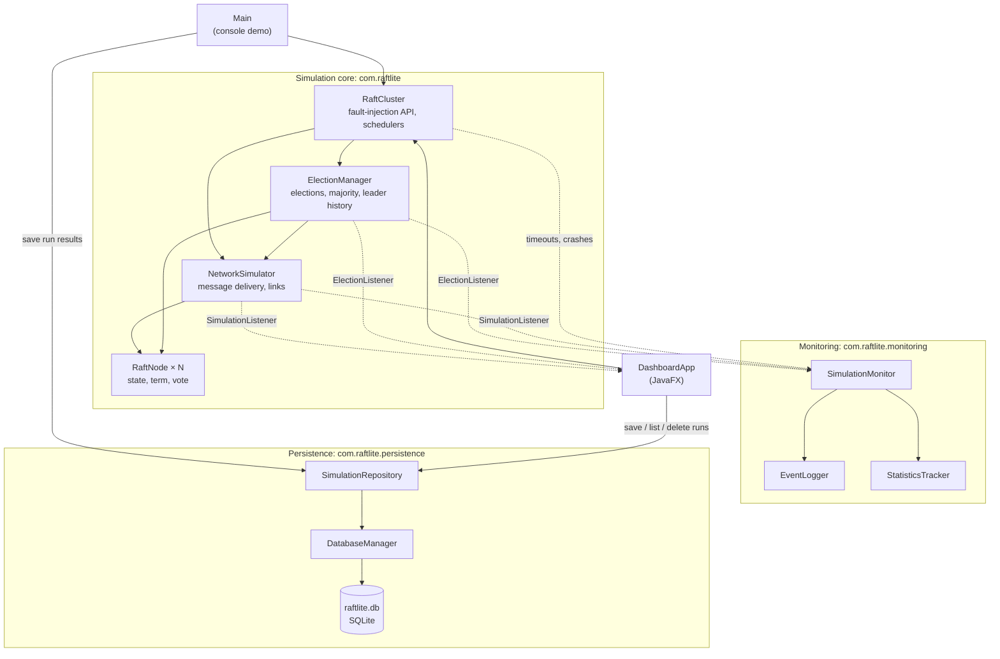
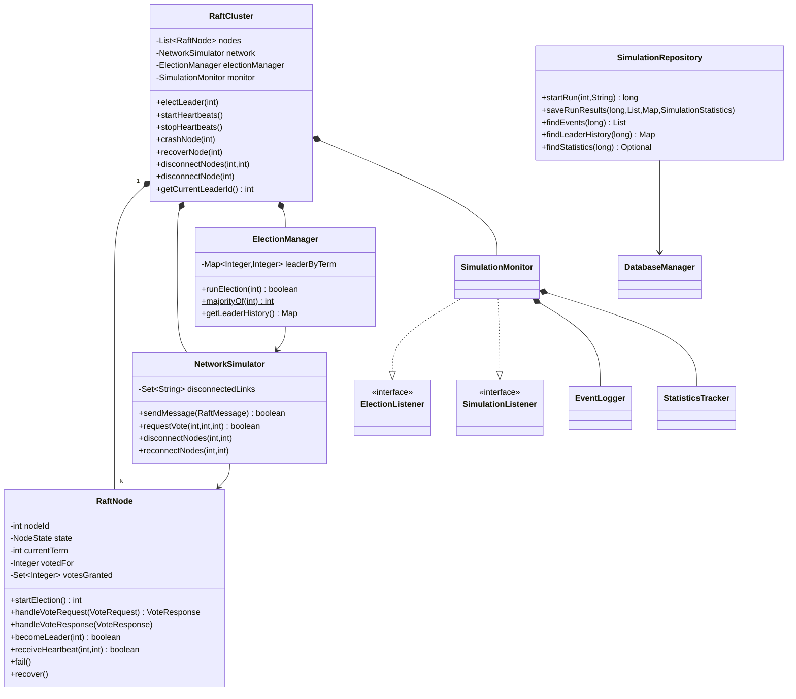
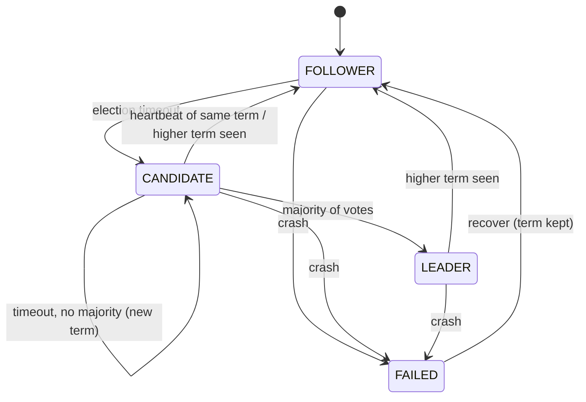
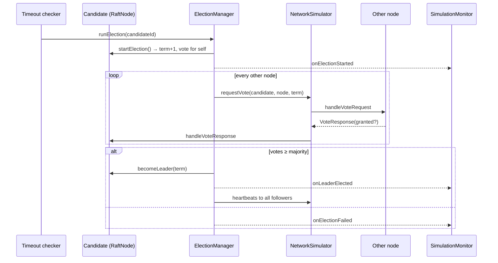

# 2. System Design

## 2.1 Architecture

RaftLite is a layered, single-process Java application. The simulation core never
depends on monitoring or storage. It only notifies *listeners*, which keeps each
module independent and testable.

| Layer | Responsibility |
|-------|----------------|
| `Main` | Runs a scripted fault scenario, then stores and prints the run. |
| `ui` (JavaFX) | Interactive dashboard: draws and animates the cluster, injects faults, shows logs, charts and stored runs. |
| Simulation core | Implements the Raft election rules and the simulated network. |
| Monitoring | Turns listener callbacks into an event log and statistics. |
| Persistence | Stores runs in SQLite through JDBC and reads them back. |

## 2.2 Components

| Class | Role |
|-------|------|
| `RaftNode` | One server. Holds `state`, `currentTerm`, `votedFor`, `leaderId`, the set of votes received and a randomized election timeout (1500 to 2500 ms). Applies the Raft rules: one vote per term, reject stale terms, step down on a higher term. |
| `ElectionManager` | Runs one election: the candidate starts a term, requests votes from every other node and becomes leader only with `⌊N/2⌋ + 1` votes. Records the leader of every term and throws `ElectionSafetyException` if a second leader is recorded for a term. |
| `NetworkSimulator` | Delivers `RaftMessage`s (VOTE_REQUEST, VOTE_RESPONSE, HEARTBEAT). Blocks messages to or from failed nodes and over cut links. A heartbeat reply carries the follower's term so a stale leader steps down. |
| `RaftCluster` | Creates the nodes, network and election manager; runs the heartbeat scheduler (every 500 ms) and the timeout checker (every 100 ms); offers `crashNode`, `recoverNode`, `disconnectNodes`, `disconnectNode`, `reconnect…`, `electLeader`. |
| `SimulationMonitor` | Implements both listener interfaces and feeds `EventLogger` and `StatisticsTracker`. |
| `EventLogger` | Thread-safe, chronological list of immutable `SimulationEvent`s with filters by type and node. |
| `StatisticsTracker` | Thread-safe counters and election-duration figures, exposed as an immutable `SimulationStatistics` record. |
| `DatabaseManager` | Opens or creates the SQLite file, enables foreign keys and applies `schema.sql`. |
| `SimulationRepository` | DAO: creates runs, saves results in one transaction, and queries runs, events, leaders and statistics. |

## 2.3 Class diagram

## 2.4 Node state machine

## 2.5 Election sequence

## 2.6 Concurrency model

- Two single-thread schedulers in `RaftCluster`: heartbeats every 500 ms and a
  timeout check every 100 ms. The demo's main thread injects faults at the same time.
- `RaftNode` methods are `synchronized`, so each node's state changes atomically.
- `ElectionManager.runElection` and `RaftCluster.electLeader` are `synchronized`, so
  only one election runs at a time.
- Listener lists and the event log use `CopyOnWriteArrayList`; statistics use
  atomic counters. Monitoring can therefore be called from any thread.
- The JavaFX dashboard never touches its controls from simulator threads.
  `UiEventBridge` (a listener) puts events in a `ConcurrentLinkedQueue`, and a
  100 ms `Timeline` on the JavaFX thread drains the queue and redraws.
- Database writes happen **once, at the end of a run**, from the main thread. The
  heartbeat threads are never slowed by I/O.

## 2.7 Design decisions

| Decision | Reason |
|----------|--------|
| Observer pattern (`ElectionListener`, `SimulationListener`) | The core does not depend on monitoring or storage, and tests can plug in their own listeners. |
| Randomized timeouts (1500 to 2500 ms) | Makes it unlikely that several nodes become candidates together and split the vote, as in the Raft paper. |
| Failed nodes still count toward the cluster size | Matches Raft: a majority is of the configured cluster, so a minority partition can never elect a leader. |
| Term and vote survive a crash | In real Raft they are on stable storage. Keeping them prevents voting twice in one term after a restart. |
| SQLite via JDBC | Zero installation and a single-file database that any SQLite viewer can open. Plain JDBC keeps the data access visible and easy to explain. |
| Save the whole run in one transaction | A run in the database is either complete or absent; it is never half written. |
| One leader per term enforced in the schema | `PRIMARY KEY (run_id, term)` on `leader_history` repeats the safety rule at the data level. |
