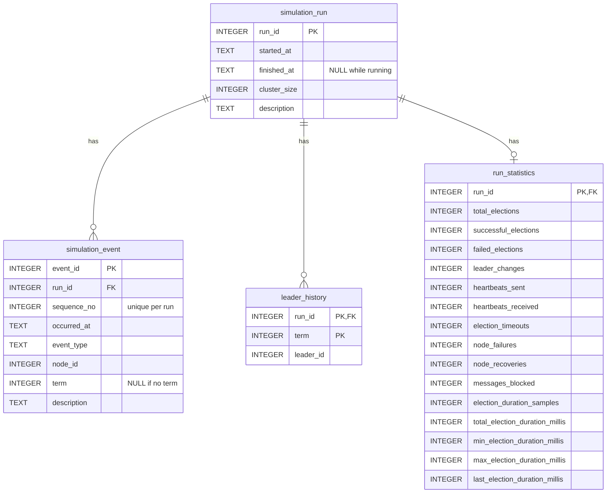
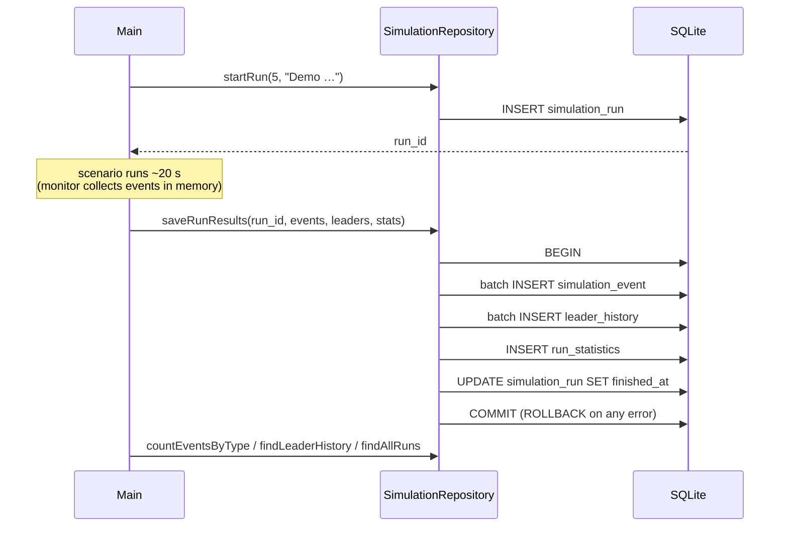

# 4. Database Integration

## 4.1 Technology

| Item | Choice |
|------|--------|
| Database | SQLite 3 (embedded, single file) |
| Driver | `org.xerial:sqlite-jdbc` 3.50.3.0 |
| Access | Plain JDBC (`PreparedStatement`, transactions) |
| Schema | `src/main/resources/db/schema.sql`, applied automatically on start |
| Default file | `raftlite.db` in the working directory (the first program argument overrides it) |

The database file is ignored by git (`*.db` in `.gitignore`).

## 4.2 Schema



### Integrity rules

- **Foreign keys** with `ON DELETE CASCADE`: deleting a run deletes all of its
  rows (`PRAGMA foreign_keys = ON` is set on every connection).
- **`PRIMARY KEY (run_id, term)`** on `leader_history`: the database itself refuses
  two leaders for one term.
- **`UNIQUE (run_id, sequence_no)`** keeps the event order exact even when several
  events share the same timestamp.
- **`CHECK`** constraints: `cluster_size > 0`, `node_id >= 0`, `term > 0`.
- Index `idx_event_run_type` on `(run_id, event_type)` for the filter and count queries.

## 4.3 Data flow



Events are buffered in memory and written in one transaction at the end, because
the heartbeat threads produce hundreds of events and must not wait on disk I/O.

## 4.4 Repository API

| Method | SQL | Purpose |
|--------|-----|---------|
| `startRun(clusterSize, description)` | `INSERT` | Create a run and return its id |
| `saveRunResults(runId, events, leaders, stats)` | `INSERT` ×3, `UPDATE`, in one transaction | Store a finished run |
| `findRun(runId)` / `findAllRuns()` | `SELECT … ORDER BY run_id DESC` | Run metadata |
| `findEvents(runId)` / `findEvents(runId, type)` | `SELECT … ORDER BY sequence_no` | Event log, optionally filtered |
| `countEventsByType(runId)` | `SELECT event_type, COUNT(*) … GROUP BY` | Aggregate counts |
| `findLeaderHistory(runId)` | `SELECT term, leader_id … ORDER BY term` | Leader per term |
| `findStatistics(runId)` | `SELECT * FROM run_statistics` | Statistics record |
| `deleteRun(runId)` | `DELETE` (cascades) | Remove a run |

Every statement uses `PreparedStatement` parameters, so no value is ever built
into SQL text.

## 4.5 Inspecting the database

Open `raftlite.db` with the `sqlite3` command-line tool or any SQLite viewer
(for example DB Browser for SQLite). Useful queries:

```sql
-- All runs, newest first
SELECT run_id, started_at, finished_at, cluster_size FROM simulation_run ORDER BY run_id DESC;

-- Leader of each term in run 1
SELECT term, leader_id FROM leader_history WHERE run_id = 1 ORDER BY term;

-- How often each node crashed, across all runs
SELECT node_id, COUNT(*) AS crashes
FROM simulation_event WHERE event_type = 'NODE_FAILED'
GROUP BY node_id ORDER BY crashes DESC;

-- Election success rate per run
SELECT run_id, ROUND(100.0 * successful_elections / total_elections, 1) AS success_pct
FROM run_statistics;

-- Timeline of elections in run 1
SELECT sequence_no, occurred_at, event_type, node_id, term
FROM simulation_event
WHERE run_id = 1 AND event_type IN ('ELECTION_STARTED', 'LEADER_ELECTED', 'ELECTION_FAILED')
ORDER BY sequence_no;
```
