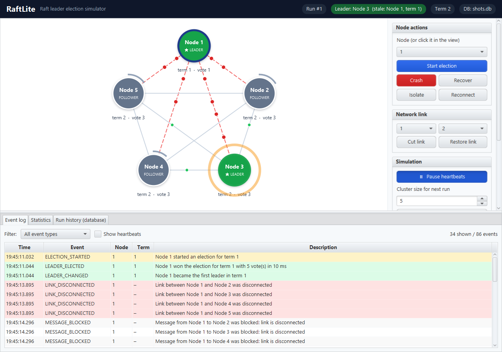

# 6. Dashboard Guide

The JavaFX dashboard shows the Raft cluster working in real time. You can click
to crash nodes or cut links and watch the cluster elect a new leader.

```bash
mvn compile javafx:run
```



## 6.1 Screen layout

| Area | What it shows |
|------|---------------|
| **Header** | Current run number, the leader (and any *stale* leader still cut off in an older term), the highest term, and the database file |
| **Cluster view** (centre) | Nodes in a ring, coloured by state, with term and vote under each. Click a node to select it |
| **Controls** (right) | Node actions, link actions, heartbeats on/off, new run |
| **Event log** tab | Every event in a table, filterable by type. Heartbeats are hidden unless "Show heartbeats" is ticked |
| **Statistics** tab | Live counters, a *term over time* line chart, and a bar chart of elections and faults |
| **Run history** tab | Runs stored in SQLite. Select one to see its leader per term and statistics; delete runs you no longer need |

### Reading the cluster view

| Visual | Meaning |
|--------|---------|
| Grey / amber / green / red node | Follower / candidate / leader / failed |
| ★ LEADER | The node believes it is the leader of its term |
| Grey arc around a node | Election timer: it fills up while the node hears nothing from a leader, and turns orange near the end |
| Amber dot | Vote request from a candidate |
| Blue / purple dot | Vote granted / rejected |
| Small green dot | Heartbeat from the leader |
| Red dot that stops halfway | Message dropped (crashed node or cut link) |
| Dashed red line | Cut network link |
| Expanding ring | Amber: election started · orange: timeout · green: leader elected |

## 6.2 Controls

| Control | Action | Validation |
|---------|--------|------------|
| Start election | The selected node becomes a candidate now | Warns if the node has failed or is already leader |
| Crash / Recover | Stop or restart the selected node | Warns if it is already failed or still running |
| Isolate / Reconnect | Cut or restore all links of the selected node | |
| Cut link / Restore link | Cut or restore the link between the two chosen nodes | Warns if both are the same node or the link is already cut |
| Start / Pause heartbeats | Run or stop the heartbeat and timeout schedulers | |
| Save run & start new | Save the current run to the database and build a new cluster of the chosen size (3 to 9) | |

Closing the window saves the current run automatically. A run in which nothing
happened is not stored.

## 6.3 Suggested demo (about 2 minutes)

1. **Start election** on Node 1. Amber vote requests go out and blue votes come
   back, and Node 1 turns green.
2. **Start heartbeats.** Green dots flow out every 500 ms, and the followers'
   timer arcs keep resetting.
3. **Isolate** Node 1. Its links turn red and the other nodes' timers fill up.
   One times out, wins term 2, and becomes leader. The header shows
   *Leader: Node X (stale: Node 1, term 1)*: the old leader does not know it was replaced.
4. **Reconnect** Node 1. Its next heartbeat reply reveals term 2, so it steps down
   to follower. This is Raft's safety in action.
5. **Crash** the new leader and watch a third election. Then **Recover** it: it
   returns as a follower.
6. Cut the links so that **two nodes are separated from three**. The minority can
   never elect a leader, because it can't reach 3 of 5 votes.
7. Open **Statistics** to see the term chart step up at each election.
8. **Save run & start new**, then open **Run history** to see the run read back
   from SQLite.

## 6.4 How it is built

| Class | Responsibility |
|-------|----------------|
| `DashboardApp` | `Application` lifecycle. `init()` opens the database, `start()` builds the `Stage` and `Scene` (`BorderPane`, `SplitPane`, `TabPane`) and starts a 100 ms `Timeline`, and `stop()` saves the run and closes the database |
| `ClusterView` | A `Pane` with layers for links, messages, nodes and effects; uses `TranslateTransition`, `FadeTransition` and `ScaleTransition` for the animations |
| `UiEventBridge` | Implements `SimulationListener` and `ElectionListener`; queues events in a `ConcurrentLinkedQueue` because simulator threads may not touch JavaFX nodes |
| `EventLogPane` | `TableView` over a `FilteredList`, plus `ComboBox` and `CheckBox` filters and coloured rows |
| `StatisticsPane` | `GridPane` of counters, a `LineChart` and a `BarChart` |
| `RunHistoryPane` | `TableView` of runs, with a `ListView` and `TextArea` for details and delete with a confirmation `Alert`; all data comes from `SimulationRepository` |
| `Dialogs` | Warning and error `Alert`s for input validation and database errors |
| `dashboard.css` | Colours and fonts |

The simulator itself was not changed for the GUI, apart from small hooks: the
`onVoteRequested` and `onVoteResponded` listener callbacks, `getNodes()`,
`isLinkConnected()`, and `addSimulationListener()` / `addElectionListener()`
on `RaftCluster`.
